# User workflows

How each kind of person moves through PeopleDesk, as the app works after the 2026-10-15 workflow round, the review fixes that followed it, and the 2026-10-16 round of status views and charts (see [Changed on 2026-10-16](#changed-on-2026-10-16), with screenshots). The personas are the six seeded employees from `/dev/login` (all synthetic). The steps are covered by the web and Worker tests, and the main ones were also driven by a scripted browser (Playwright) against `npm run dev` with these personas, at 1280px and 375px wide, in light and dark themes. Dates and counts below are those of the local dataset, whose business date is 2026-10-01. None of it was checked in production.

Two rules hold in every workflow:

- Nothing that changes a record happens until the requesting person presses Approve on the request's card. A form, chat and an MCP client can only propose; the server checks every proposal and every approval.
- Each step of a request has its own URL (`?review=`, `?edit=`, `?from=` on `/requests/ticket` and `/requests/orientation`), so a reload, Back or a shared link shows the request as the server has it now.

## Personas

| Persona | Employee | Situation |
|---|---|---|
| New hire, not booked | Nadia Fernandes (E0025), US | In onboarding, no orientation booking |
| New hire, booked | Gabriel Kowalski (E0022), IN | In onboarding, booked into ORI-008 |
| Tenured employee | Emeka Adeyemi (E0023), IN | No onboarding plan |
| Manager with new hires | Deepa Foster (E0007), US | 12 direct reports, 5 in onboarding |
| Manager without new hires | Chen Varma (E0014), US | Direct reports, none in onboarding |
| HR admin | Kenji Nakamura (E0016), IN | Sees everyone with an onboarding plan (30 people) |

Locally, a reviewer signs in as any of them; in production, Cloudflare Access signs a person in and an identity link maps them to an employee.

## Everyone

### Sign in locally, or switch persona

1. Open `/dev/login` (or follow "Switch persona" in the header, or the sign-in link on a signed-out page).
2. Pick a persona. PeopleDesk opens the page you came from (`?next=`), or Home.
3. If no personas load, the page says to run `npm run seed:local`. If the token request fails, the page shows the status and the server's message.

### When the session ends or the network drops

1. A request that answers 401 after the app has loaded shows one banner: "Your session has ended. Reload the page to sign in again." with Reload (and "Pick a persona" locally). Error banners offer Reload instead of Try again for a 401.
2. An identity with no employee record sees that it is not linked and should ask the administrator to link it; there is no reload advice and no navigation.
3. A request that got no response says PeopleDesk could not be reached; an HTML error page from a proxy says PeopleDesk is temporarily unavailable, with its status.
4. In production the header offers "Sign out" (Cloudflare Access logout).

### Ask a policy question

1. Open Chat and type a question, or pick a suggestion. A suggestion clicked twice still starts one conversation.
2. While PeopleDesk works, the composer is disabled; after 5 seconds the page shows the elapsed time and that answers can take up to a minute.
3. The answer cites its sources as chips (title, document, version, effective date). Focus returns to the message box if you sent from it or from a suggestion.
4. Open a chip to read the cited passage in a dialog. Tab stays inside it; Escape, Close or the backdrop closes it and returns focus to the chip, and the version link opens that version's page.
5. A screen reader hears "PeopleDesk is working on it" and then the new reply, but not a transcript loaded from history.
6. If a send fails, Retry sends it again under the same message, and focus comes back to the message box when it is done. If the rate limit is reached, Retry and Send wait for the countdown shown under the box. If a previous reply is still being prepared, the page waits for it (up to a minute), shows it, and keeps Retry for the new message.
7. On a phone the conversation list folds behind "Conversations (N)"; picking a conversation from it folds it again and moves focus to that toggle. A link to a conversation that does not exist (or is someone else's) says so, and a message sent there starts a new conversation.

### Open a support ticket from the form

1. New ticket (`/requests/ticket`): choose a category, write a subject and description, pick a priority (Low, Normal, High), and optionally a related policy (suggestions list the policies you can read).
2. Review request. A problem is named in plain words under its field ("Subject needs at least 5 characters."), one summary lists the fields to fix, and focus moves to the first one. A related policy you cannot read is flagged under that field.
3. The review step (`?review=<id>`) shows exactly what will be written, labeled as on the form (Priority "Normal"), with Approve, Reject and Edit and the time left. Focus moves to the step's heading, so the next Tab reaches Approve. A reload shows the same card.
4. Edit opens the prefilled form (`?edit=<id>`); Update request replaces the old request, and the page moves to the new request's review step. Each step change moves focus to the new step's heading. Back shows the old request as "replaced" ("Replaced by an edited request"), with a link to the new one.
5. Approve. The card shows "Done: ticket TKT-000151 was created." with "View in My tickets", and focus moves to that outcome. Reject shows that nothing was submitted, with "Start again with these details" (`?from=<id>`).
6. If five requests are already waiting, the refusal links to My requests.

### Make a request in chat and approve it

1. Ask in chat ("Please open an IT ticket, my laptop will not boot"). The reply is an approval card.
2. Approve on the card, or Edit to open the form (focus moves to its heading); the form and the review step after it offer "Back to conversation".
3. When the card proposed in chat is itself approved, the conversation records the outcome ("Approved and done: TKT-000153." or "Approved and done: booked into ORI-006."). A request edited on the form has no conversation of its own, so approving it writes no note there: its outcome is on the original card under "See the new request", and in My requests.
4. Reopening the conversation later shows each card in its current state (approved, rejected, replaced or expired), with its next step.

### Approve from a link (an MCP client's `approvalUrl`)

1. Open `/actions?focus=<id>`. The page loads your requests, scrolls to that card, highlights it and moves keyboard focus to it.
2. Approve or Reject there. A request that is not yours says it was not found among yours, with a link to all your requests.
3. With no requests at all, the page links to a new ticket and to chat (after a focus link, it says that request was not found first, without a "See all your requests" button that would lead to the same empty page).

### Follow your tickets

1. My tickets lists the tickets you opened, labeled as the form labels them (IT, HR (general), In progress).
2. The status buttons are also the counts ("All 5", "Open 3", "In progress 0", "Resolved 2", "Closed 0"). The list is asked for once, so changing the filter makes no request. The filter is part of the URL (`/tickets?status=open`), so it survives a reload and Back. A filter with no tickets offers to show all statuses, which moves focus to All.
3. Last update, right after Subject, says how long each ticket has gone without an update ("Mar 22, 2026, 193 days ago"). An open or in progress ticket with no update for 30 days or more also says "No update in 193 days", so the one to chase stands out.

### Read policies

1. Policies lists what you can read at today's version. Search and category are part of the URL, and the list is asked for once typing pauses; Back from a document returns to the same filtered list.
2. Above the list, Policy changes shows what is coming up (soonest first) and what took effect in the last 90 days (newest first), among the policies you can read, for the chosen category: the date and how soon or how long ago ("Jan 1, 2027, in 92 days"), the title linked to that version, "version 1 to 2" or "new policy", and the change summary. Each group shows four until Show all. An employee sees 8 coming up and 10 recent; a manager 14 recent and HR 17.
3. Nothing matching offers Clear filters (focus then goes to the search box) and Ask in chat.
4. A document shows its version timeline and what changed from the previous version. The timeline marks "Today: Oct 1, 2026" between scheduled and earlier versions, and a scheduled version says how soon ("in 151 days"). The current version notes a scheduled version ("Version N takes effect on <date>.") with a link; a superseded version links to the current one.
5. A version that does not exist (`/v/abc`, `/v/99`) says so and links to the current version. A document above your clearance reads "Policy not found", the same as a missing one.

## New hire, not booked (Nadia)

1. Home shows "Your onboarding": the task bar with "9 of 12 done · 3 overdue · 2 waiting on your manager", "Next for you: Book orientation. Your orientation task was due Sep 21, 2026.", "Orientation: not booked yet.", Book orientation and View checklist. If the booking cannot be checked, Home says so, with Try again.
2. Book orientation lists sessions in your region and Global first (the Region filter has the others and "All regions"), grouped by week. Above the table: "Your orientation task was due Sep 21, 2026." and "Soonest open session: New Hire Orientation (Global, virtual) (ORI-004), Oct 22, 2026 15:00 UTC, in 21 days" with Choose it, which checks that session and moves focus to it. Seats read "Full", "Only 2 left" or "18 of 19 left". Click a session's title to choose it; full sessions cannot be chosen. A screen reader hears each session's title, id, place and start, then its seats.
3. Review request without a session says "Choose a session." and moves focus to the first open session.
4. Review, Edit or Approve as in the ticket workflow. The approved card names the attendee, the session and its start (in the scripted run: "Done: Nadia Fernandes (E0025) is booked into New Hire Orientation (UK, virtual) (ORI-003), starting 2026-10-19 10:00 UTC.", a session picked on the edit step, which shows all regions) with "View onboarding".
5. Onboarding shows your checklist as next steps: the plan header ("Day 55 of 90 · target Nov 5, 2026 · 9 of 12 done · 3 overdue", then whether you are booked), Overdue (your orientation task, with Book orientation while unbooked), Waiting on someone else (two tasks owned by your manager, blocked and overdue), and Done (9) folded. After a booking is approved, the header says which session and how soon.
6. If the session filled up before the approval, the card offers "Pick another session", which opens the form with that session marked full and nothing chosen ("ORI-003 is full now. Choose another session."); it cannot be sent again.

## New hire, booked (Gabriel)

1. Home shows "Your onboarding" with "3 of 12 done · 3 overdue · 4 waiting on others: your manager 2, HR 2", "Next for you: Enroll in multi-factor authentication, overdue since Sep 22, 2026" and "Orientation: Oct 31, 2026 16:00 UTC, in 30 days".
2. Orientation says "You're booked into New Hire Orientation (US, in person) (ORI-008) on Oct 31, 2026 16:00 UTC, Austin Office, Training Room 2." with a link to Onboarding, and no form (and no subtitle about picking a session).
3. Onboarding shows the same booking, with "(in 30 days)", in the plan header, then Overdue (2), Due in the next 7 days (2), Later (1), Waiting on someone else (4, with Team introductions "Due today", not overdue) and Done (3).

## Tenured employee (Emeka)

1. Home offers Ask a question, New ticket, My tickets and Policies; no orientation or onboarding card.
2. Orientation explains that sessions are for people in onboarding and links to Policies and Chat; there is no form and no subtitle about picking a session.
3. Onboarding says there is no plan and links to Chat and a new ticket.

## Manager with new hires (Deepa)

1. Home shows an Onboarding panel: "5 in onboarding" and three tiles, 3 not booked, 1 with blocked tasks and 3 with overdue tasks, each a link to Onboarding filtered that way (focus lands on the page heading, with that tile pressed). Book orientation still says how many reports need a session ("3 people need an orientation session").
2. Onboarding counts your reports in four tiles that filter the list (In onboarding 5, Not booked 3, With blocked tasks 1, With overdue tasks 3; they can overlap). "Where onboarding is stuck" lists the checklist steps with blocked or overdue tasks among your reports ("7 stuck tasks: 1 blocked, 6 overdue. Owners: New hire 6, You 1"); a step's name filters the list to the people stuck on it and moves focus to "Showing 1 person stuck on First one-on-one with your manager", with Show everyone.
3. Each row shows the person's name, their orientation date or Not booked, a task bar (done, overdue, not due yet) and a line such as "6 of 12 done · 3 overdue · day 25 of 90". The list starts with whoever needs attention (Elijah, Jasmine, Olivia, Zara, then Hana, who starts in 15 days); Sort offers Name and Start date. The filter, step, sort and selected person are in the URL. Select a name to see their checklist as next steps, with your own tasks as "You" (for Elijah, "First one-on-one with your manager" is overdue and yours) and Book orientation on the orientation task while unbooked; while it loads the pane says so, and a failure offers Try again. The list comes first, on screen and for a screen reader: left of the checklist on a laptop, above it on a phone. On a phone, selecting a name moves focus to the checklist's heading ("Zara Kim's checklist") and scrolls it to the top.
4. "Book orientation" on an unbooked row opens the booking form with that person chosen (`?employee=E0024`), all regions shown. For Olivia the table has a row "Orientation task due Oct 21, 2026 for Olivia Morgan" after ORI-003 (Oct 19); ORI-004 onward say "after the due date". Every open session can still be chosen. Opened from Home, with several people to book for, the form asks you to choose an attendee instead of picking the first.
5. Review and approve as above. Reports who are already booked are not offered. If the person a link or an edited request names was booked in the meantime, the form says so ("Zara Kim (E0033) already has an orientation session.") and asks you to choose an attendee; it never puts someone else in their place.
6. If your team cannot be loaded, Home says so with Try again, instead of leaving out Book orientation.

## Manager without new hires (Chen)

1. Home has no orientation action; Onboarding says no one you support is in onboarding, with no Book orientation link.
2. Orientation says the same and links to Onboarding; there is no form and no subtitle about picking a session.

## HR admin (Kenji)

1. Home and Onboarding cover everyone in onboarding (30 people: 12 not booked, 14 with blocked tasks, 19 with overdue tasks), with the same tiles, task bars, sort and Book links as a manager. "Where onboarding is stuck" shows that 9 people are stuck on "Enroll in multi-factor authentication" (3 blocked, 6 overdue) and 6 on "First one-on-one with your manager", owned by their managers; HR's own steps read "HR (you)".
2. Orientation lets HR choose any unbooked person in onboarding as the attendee; the attendee list starts on "Choose an attendee" unless a link names someone.

## Changed on 2026-10-15

- **Request steps have URLs.** Before, a reload after Edit and Update showed the stale edit form for a request already replaced, and its Update failed with a conflict; a reload on the review step dropped the card and invited a duplicate request. Now `?review=`, `?edit=` and `?from=` read the request from the server, and an edit of a decided request shows what happened instead of a form.
- **Approval cards show the outcome and the next step.** Decided cards kept three disabled buttons and no way forward; an expired card even disabled Edit. Now each outcome links to the next step, focus moves to it, a 409 or 410 shows the true state instead of a generic error, and the countdown no longer speaks every second. The chat note for a booking names the session instead of the booking's internal id.
- **Orientation knows who can book.** The tenured employee and a manager without reports in onboarding got a form whose only result was a refusal, a failed team load read as "No one in onboarding needs a booking", and the booked new hire could not see his session anywhere. A new read-only route, `GET /api/orientation-booking`, returns only the caller's own booking. The picker has a region filter, labels as click targets and loading and error states.
- **Chat is harder to break.** A double click made two conversations, switching showed the old transcript with the composer enabled, a dead link posted to a dead id, Retry duplicated the message, and a rate limit or a reply still in progress left the person stuck.
- **Chat works by keyboard and screen reader.** Focus fell to the page after every reply, the source drawer did not trap focus or return it, and the whole transcript was a live region.
- **Session and connection problems say what to do.** A 401 and a 403 both read "session expired, reload", a dropped connection showed "Failed to fetch", and dev login always went to `/`. Now each case has its own message and next step, and the header has Switch persona or Sign out (the Sign out link was not checked in production).
- **The app reads well and works on a phone.** Light-theme primary buttons had dark text on blue (2.45:1) and the faint text was 3.67:1; both now pass 4.5:1. There is a skip link, a title per page, one h1 per page and focus on the new page after navigation; the brand no longer reloads the app; and at 375px all seven nav links are visible instead of scrolling sideways.
- **Onboarding is an overview, and Home fits the person.** HR saw 30 names with only a booked pill and no way to act; a failed checklist showed Loading forever; switching people showed the previous checklist. Home offered Schedule orientation to people who could not book.
- **Tickets explain problems in plain words.** zod's own messages ("Too small: expected string to have >=5 characters") and a raw server string are replaced by field messages, a summary and focus on the first problem; labels are the same everywhere; the status filter survives a reload.
- **Policies keep their filters.** Back from a document reset the search, every keystroke fetched the list, and a bad version link showed Loading forever or a Try again that could not help.

## Fixed after a review of the workflow round (2026-10-15)

A review walked the same personas by keyboard, screen reader output and at 375px, and reported 20 findings. Each was confirmed here before it was fixed; none was rejected.

- **Focus no longer drops to the page between request steps.** Review request, Edit, Update request, Start again and See the outcome remounted the step and removed the focused button, so a keyboard user started again from the skip link. Now the new step's heading takes focus once the request has loaded, also after Edit on a chat card.
- **A prefilled booking keeps its attendee and never resends a full session.** The edit form quietly put the first listed person in place of an attendee who had been booked meanwhile, and Update request then proposed a booking for that other person; "Pick another session" preselected the same full session and sent it again. Now the form says why the named person or session cannot be booked and asks for a choice.
- **Cards read as they should.** The card showed Priority "normal" while the form says "Normal"; a replaced request read "rejected"; the time left was hidden from screen readers. The Worker's preview now labels priority as the form does, the pill says "replaced", and the expiry is readable (it is in no live region, so it is never read out as it changes).
- **Session radios have full names.** Six sessions share one title, and each radio's name was only the title and id; it now includes the place and the start.
- **Focus stays useful in chat, Policies and My tickets.** Retry, picking a conversation on a phone, Clear filters and Show all statuses each removed or hid the focused control; focus now goes to the message box, the Conversations toggle, the search box and the status filter.
- **Phone layouts.** The folded conversation list no longer stretches into an empty box above the composer. On Onboarding the people list is first in the page as well as on screen, so selecting someone no longer leaves focus far above the checklist.
- **No dead ends or silent gaps.** The orientation subtitle no longer sits above "you're booked" or "you cannot book"; Onboarding no longer offers a booking link to a manager with no one in onboarding; Home says when the booking or the team cannot be checked; a focus link with no requests shows one message. The user badge keeps the name readable to screen readers on a phone.
- **Dev login.** `?next=` resolves dot segments before refusing `/dev/` targets (`/x/../dev/login` used to pass). It was never an open redirect.

## Changed on 2026-10-16

A round of status views and charts, each answering a question one of the personas has. The data comes from what the API already returned, plus two small read-only routes: `GET /api/team/onboarding` (the people a manager or HR admin may already open one by one, with task counts against due dates and the stuck checklist steps, in one D1 batch after the directory slice) and `GET /api/policy-changes` (one indexed statement, metadata only). The business date that "overdue" and "in 21 days" are measured against is the `/api/health` answer the app already asked for. Every chart prints its numbers as text, uses the app's tokens in light and dark (`--chart-done` and `--chart-overdue` pass the dataviz palette checks against each other), and was checked at 375px and 1280px in both themes with no sideways scroll.

- **Onboarding is an overview with status at a glance (Kenji, Deepa).** "Of the people I support, who is behind, who is blocked, who still needs orientation, and whom do I open first?" Before, the list showed 30 rows in employee id order with "58% complete · 1 blocked", and nothing was measured against due dates. Now four tiles count people and filter, each person has a task bar and a text line, and the list puts whoever needs attention first.

  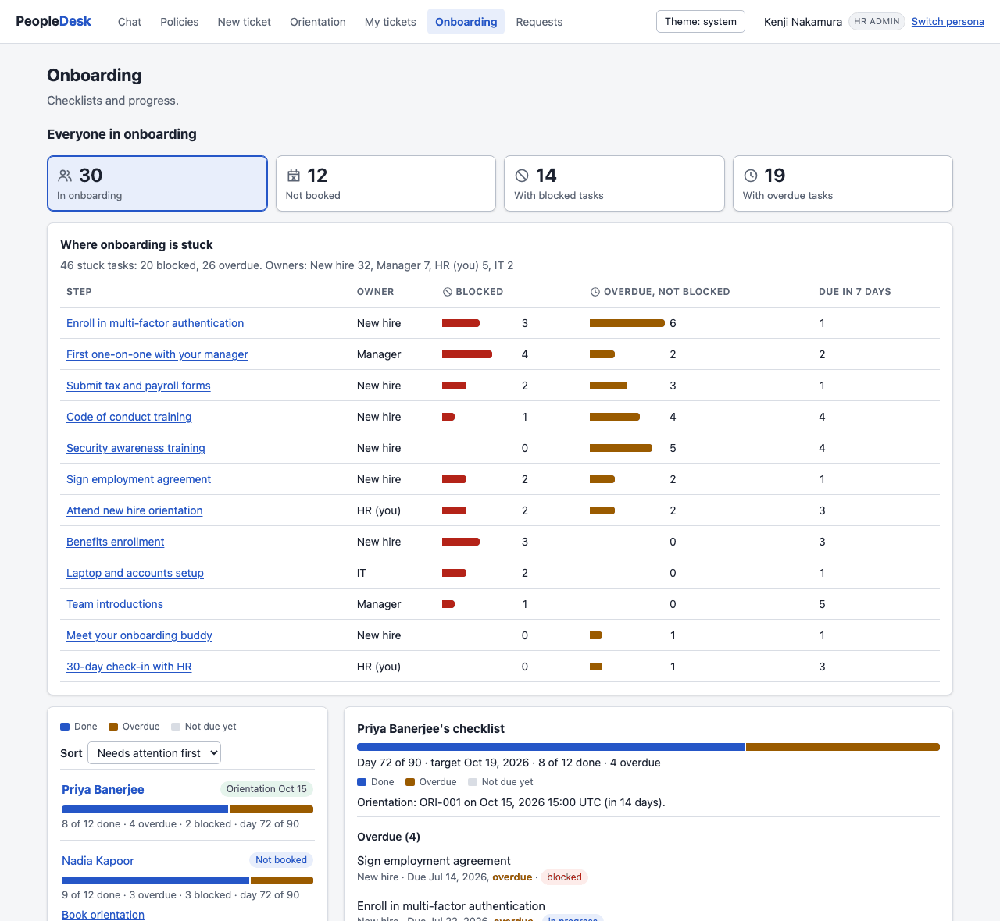

  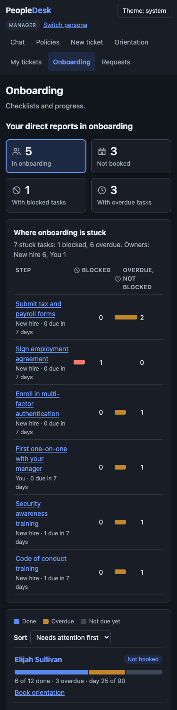

- **Where onboarding is stuck (Kenji, Deepa).** "Which step is holding people up, and who owns it?" A table of checklist steps with blocked and overdue tasks, with bars on one scale beside the numbers; a step filters the list to its people. Owner says who owns the step, not who must unblock it.
- **Checklists are next steps (Nadia, Gabriel, and the manager and HR pane).** "What do I need to do now, what is overdue, and what am I waiting on?" Before, a 12-row table in template order with blocked manager tasks among done rows, and nothing marked overdue. Now a plan header with the task bar, then Overdue, Due in the next 7 days, Later, Waiting on someone else (your own checklist only) and Done folded. Nadia's page at 375px went from 1,548px to 900px tall. Without the business date the page shows the old table and never says overdue; the chat's onboarding card is unchanged.

  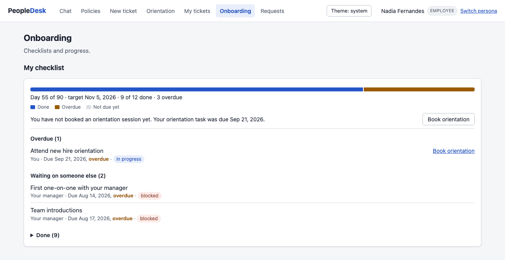

  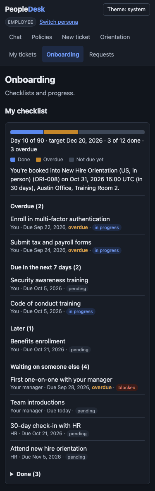

  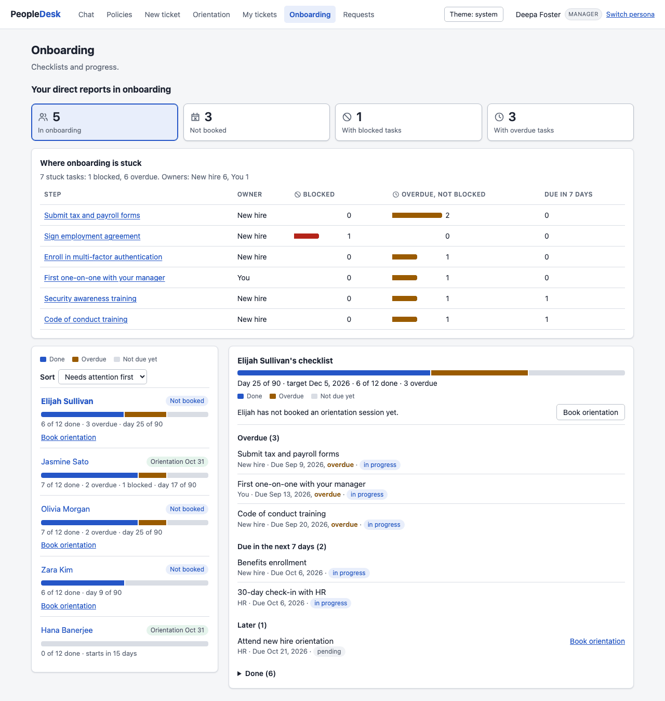

- **Home at a glance (everyone in onboarding, and the people who support them).** A new hire sees their task bar, the next thing to do and their booking; a manager or HR admin sees link tiles that open Onboarding filtered. Home makes the same number of requests as before (`/api/team/onboarding` replaced `/api/team` there).

  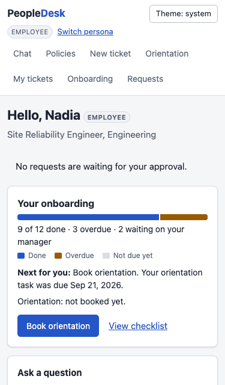

  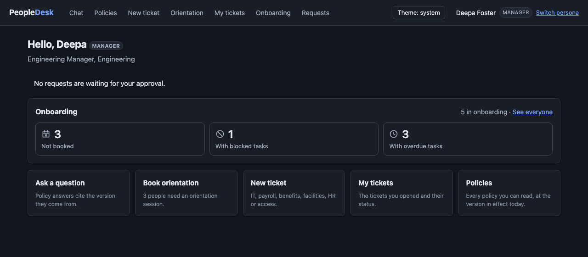

- **The orientation picker shows the soonest session and the due date (Nadia, Deepa, Kenji).** "Which is the soonest session with seats, and is it before this person's orientation task is due?" Sessions are grouped by week, seats are plain text, Choose it picks the soonest open session in the filter, and the attendee's due date sits among the sessions. It is information only; the server still decides. Nadia's page at 375px went from 2,025px to 1,975px tall.

  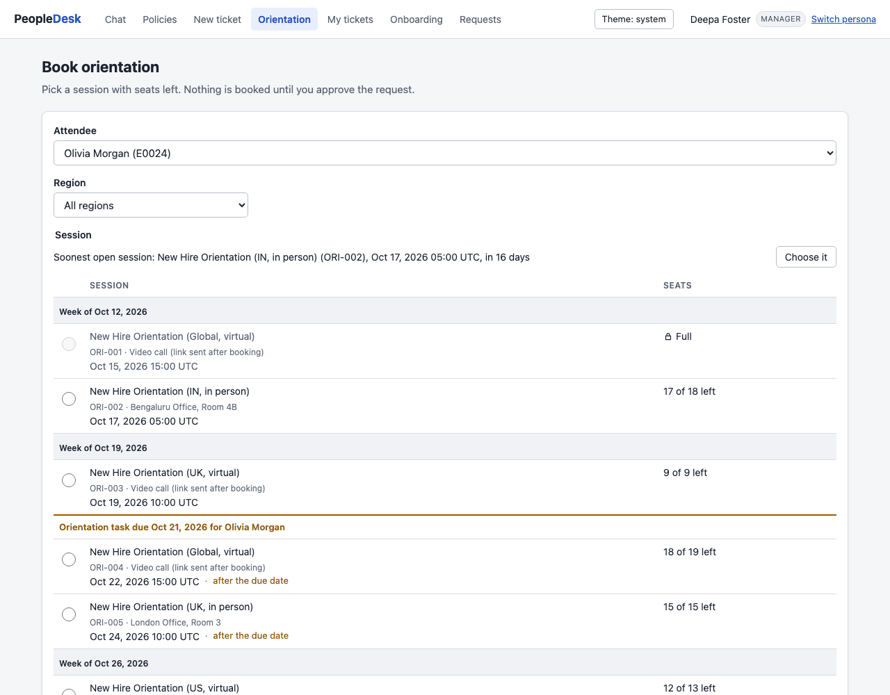

  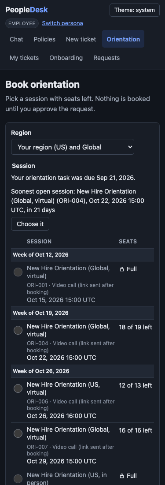

- **My tickets says which ticket has waited longest (everyone).** The status buttons carry the counts, and Last update shows each ticket's age; Emeka's three open tickets were last updated 193, 120 and 118 days before the business date. The chat's ticket card is unchanged.

  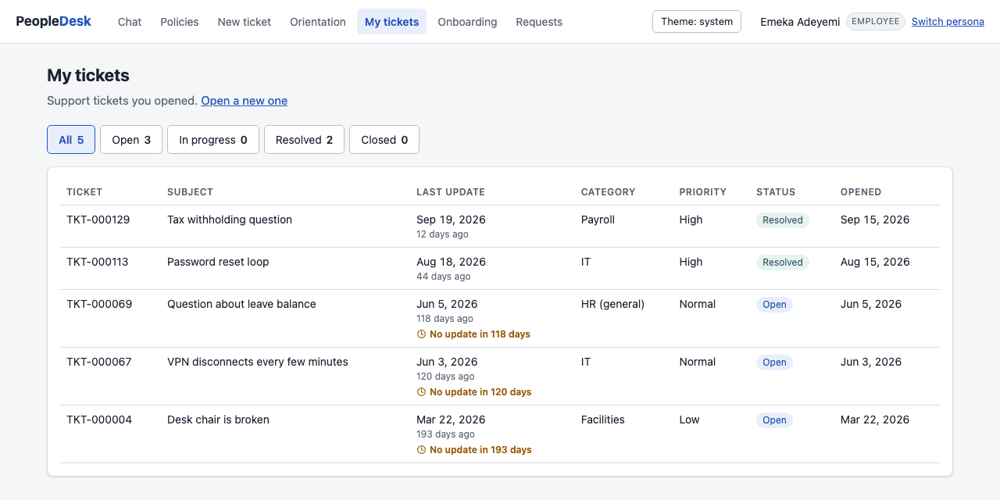

  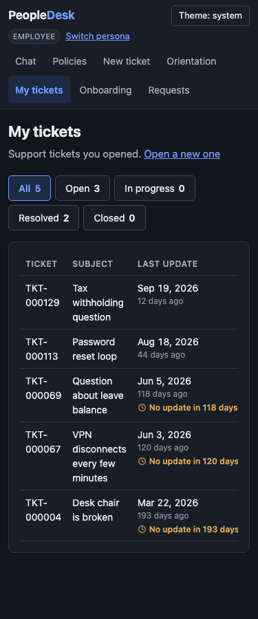

- **Policies say what changed and what is coming (everyone).** Before, a scheduled version was visible only inside its own document. Now Policy changes sits above the list, and a document's timeline marks today.

  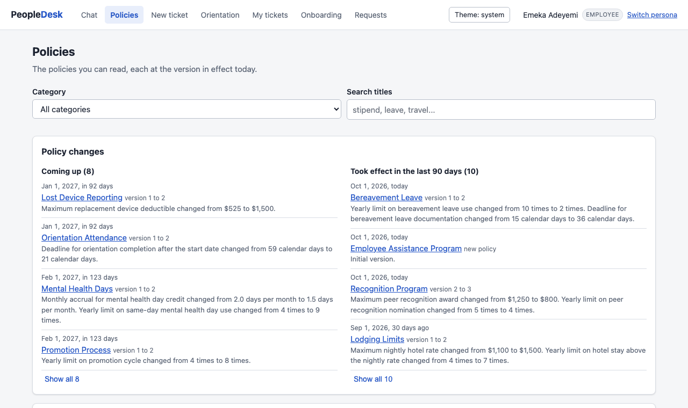

  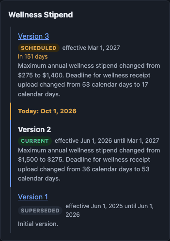

- **Without color.** In forced colors (Windows high contrast) the task bar's segments are solid, hatched and outlined, and every value is also in the text line.

  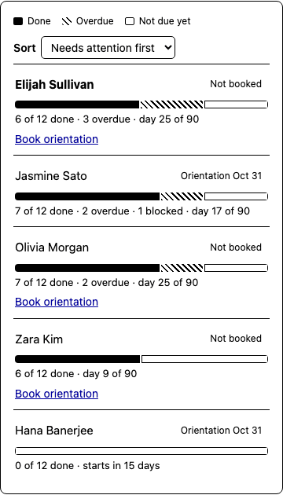

